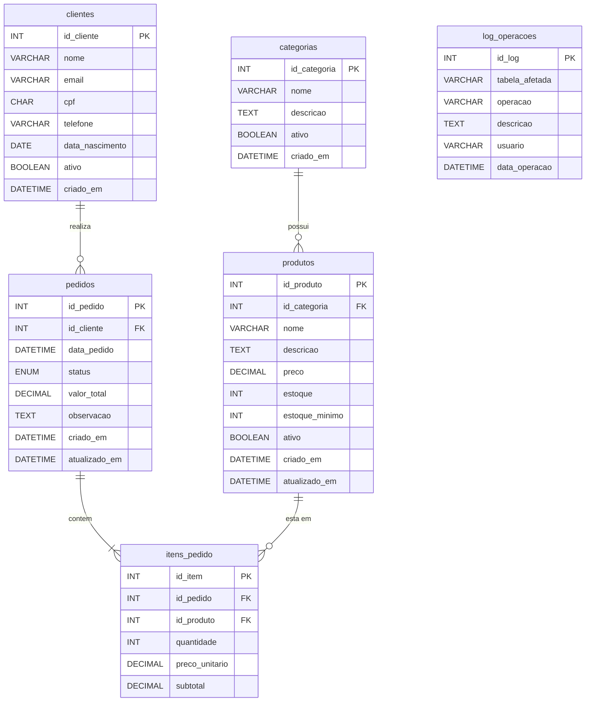

# db_loja_tech

# 🛒 TechStore Database — Consultas SQL, Stored Procedures e Views


Repositório desenvolvido para a atividade prática da disciplina de **Banco de Dados**, utilizando o ecossistema relacional da loja fictícia **TechStore** (`loja_tech`). O projeto contempla a modelagem do banco de dados, resolução de 10 desafios de consultas SQL, implementação de 5 *Stored Procedures* seguindo boas práticas de engenharia de dados e um estudo comparativo com exemplos práticos de *Views*.

---

## 📑 Sumário

1. [Estrutura do Repositório](#-estrutura-do-repositório)
2. [Modelo Entidade-Relacionamento (DER)](#-modelo-entidade-relacionamento-der)
3. [Dicionário de Dados (Esquema das Tabelas)](#-dicionário-de-dados-esquema-das-tabelas)
4. [Esquema das Stored Procedures](#-esquema-das-stored-procedures)
5. [Pesquisa e Esquema das Views (5 Exemplos Práticos)](#-pesquisa-e-esquema-das-views-5-exemplos-práticos)
6. [Resumo das Consultas SQL (Parte 1)](#-resumo-das-consultas-sql-parte-1)
7. [Como Executar o Projeto](#-como-executar-o-projeto)
8. [Referências Bibliográficas](#-referências-bibliográficas)

---

## 🗂️ Estrutura do Repositório

```text
📁 techstore-sql-procedures/
 ├── 📄 schema_loja_tech.sql       # Script DDL/DML: criação do banco, 6 tabelas e carga inicial
 ├── 📄 resolucao_atividade.sql    # Script completo: 10 consultas SQL + 5 Stored Procedures + testes
 ├── 📄 views_exemplos.sql         # Script com as 5 Views pesquisadas e seus respectivos SELECTs
 └── 📄 README.md                  # Documentação completa, DER, esquemas e referências
```

---

## 📐 Modelo Entidade-Relacionamento (DER)

Abaixo está a arquitetura relacional do banco `loja_tech`, renderizada nativamente via **Mermaid**:



---

## 🗄️ Dicionário de Dados (Esquema das Tabelas)

O banco de dados `loja_tech` utiliza codificação `utf8mb4` (`utf8mb4_0900_ai_ci`) e é composto por **6 tabelas**:

### 1. Tabela `categorias`
Agrupa os produtos do catálogo (ex.: Notebooks, Smartphones, Periféricos).

| Coluna | Tipo de Dado | Restrições / Padrão | Descrição |
| :--- | :--- | :--- | :--- |
| `id_categoria` | `INT` | `PRIMARY KEY`, `AUTO_INCREMENT` | Identificador único da categoria. |
| `nome` | `VARCHAR(100)` | `NOT NULL` | Nome da categoria. |
| `descricao` | `TEXT` | `NULL` | Descrição detalhada da categoria. |
| `ativo` | `BOOLEAN` | `DEFAULT TRUE` | Indica se a categoria está visível/ativa no sistema. |
| `criado_em` | `DATETIME` | `DEFAULT CURRENT_TIMESTAMP` | Data e hora de criação do registro. |

### 2. Tabela `produtos`
Armazena o catálogo de produtos comercializados pela loja.

| Coluna | Tipo de Dado | Restrições / Padrão | Descrição |
| :--- | :--- | :--- | :--- |
| `id_produto` | `INT` | `PRIMARY KEY`, `AUTO_INCREMENT` | Identificador único do produto. |
| `id_categoria` | `INT` | `NOT NULL`, `FOREIGN KEY` | Referência à tabela `categorias(id_categoria)`. |
| `nome` | `VARCHAR(200)` | `NOT NULL` | Nome comercial do produto. |
| `descricao` | `TEXT` | `NULL` | Especificações técnicas do produto. |
| `preco` | `DECIMAL(10,2)` | `NOT NULL` | Preço unitário de venda (R$). |
| `estoque` | `INT` | `NOT NULL`, `DEFAULT 0` | Quantidade disponível em estoque. |
| `estoque_minimo` | `INT` | `NOT NULL`, `DEFAULT 5` | Nível mínimo de alerta para reposição. |
| `ativo` | `BOOLEAN` | `DEFAULT TRUE` | Status de disponibilidade do item. |
| `criado_em` | `DATETIME` | `DEFAULT CURRENT_TIMESTAMP` | Data de cadastro do produto. |
| `atualizado_em` | `DATETIME` | `ON UPDATE CURRENT_TIMESTAMP` | Data da última alteração no registro. |

### 3. Tabela `clientes`
Cadastro dos clientes da TechStore.

| Coluna | Tipo de Dado | Restrições / Padrão | Descrição |
| :--- | :--- | :--- | :--- |
| `id_cliente` | `INT` | `PRIMARY KEY`, `AUTO_INCREMENT` | Identificador único do cliente. |
| `nome` | `VARCHAR(150)` | `NOT NULL` | Nome completo do cliente. |
| `email` | `VARCHAR(200)` | `NOT NULL`, `UNIQUE` | E-mail de contato e acesso (único). |
| `cpf` | `CHAR(11)` | `NOT NULL`, `UNIQUE` | CPF sem pontuação (11 dígitos, único). |
| `telefone` | `VARCHAR(15)` | `NULL` | Telefone com DDD. |
| `data_nascimento` | `DATE` | `NULL` | Data de nascimento do cliente. |
| `ativo` | `BOOLEAN` | `DEFAULT TRUE` | Indica se o cadastro está ativo. |
| `criado_em` | `DATETIME` | `DEFAULT CURRENT_TIMESTAMP` | Data de cadastro do cliente. |

### 4. Tabela `pedidos`
Cabeçalho dos pedidos realizados na plataforma.

| Coluna | Tipo de Dado | Restrições / Padrão | Descrição |
| :--- | :--- | :--- | :--- |
| `id_pedido` | `INT` | `PRIMARY KEY`, `AUTO_INCREMENT` | Número identificador do pedido. |
| `id_cliente` | `INT` | `NOT NULL`, `FOREIGN KEY` | Referência à tabela `clientes(id_cliente)`. |
| `data_pedido` | `DATETIME` | `DEFAULT CURRENT_TIMESTAMP` | Data e hora em que o pedido foi gerado. |
| `status` | `ENUM(...)` | `DEFAULT 'pendente'` | Valores: `'pendente'`, `'processando'`, `'enviado'`, `'entregue'`, `'cancelado'`. |
| `valor_total` | `DECIMAL(10,2)` | `DEFAULT 0.00` | Valor total consolidado do pedido. |
| `observacao` | `TEXT` | `NULL` | Notas adicionais ou histórico do pedido. |
| `criado_em` | `DATETIME` | `DEFAULT CURRENT_TIMESTAMP` | Timestamp de criação. |
| `atualizado_em` | `DATETIME` | `ON UPDATE CURRENT_TIMESTAMP` | Timestamp da última atualização de status/valor. |

### 5. Tabela `itens_pedido`
Detalhamento dos produtos vinculados a cada pedido.

| Coluna | Tipo de Dado | Restrições / Padrão | Descrição |
| :--- | :--- | :--- | :--- |
| `id_item` | `INT` | `PRIMARY KEY`, `AUTO_INCREMENT` | Identificador único da linha do item. |
| `id_pedido` | `INT` | `NOT NULL`, `FOREIGN KEY` | Referência à tabela `pedidos(id_pedido)`. |
| `id_produto` | `INT` | `NOT NULL`, `FOREIGN KEY` | Referência à tabela `produtos(id_produto)`. |
| `quantidade` | `INT` | `NOT NULL`, `DEFAULT 1` | Quantidade comprada do produto. |
| `preco_unitario` | `DECIMAL(10,2)` | `NOT NULL` | Preço unitário praticado no momento da compra. |
| `subtotal` | `DECIMAL(10,2)` | `GENERATED ALWAYS AS (...) STORED` | Coluna calculada automaticamente (`quantidade * preco_unitario`). |

### 6. Tabela `log_operacoes`
Tabela de auditoria e rastreabilidade de operações realizadas no banco.

| Coluna | Tipo de Dado | Restrições / Padrão | Descrição |
| :--- | :--- | :--- | :--- |
| `id_log` | `INT` | `PRIMARY KEY`, `AUTO_INCREMENT` | Identificador único do registro de log. |
| `tabela_afetada` | `VARCHAR(100)` | `NULL` | Nome da tabela onde ocorreu a operação. |
| `operacao` | `VARCHAR(50)` | `NULL` | Tipo de ação (`INSERT`, `UPDATE`, `DELETE`, etc.). |
| `descricao` | `TEXT` | `NULL` | Detalhes descritivos do evento registrado. |
| `usuario` | `VARCHAR(100)` | `DEFAULT (CURRENT_USER())` | Usuário do banco que executou a operação. |
| `data_operacao` | `DATETIME` | `DEFAULT CURRENT_TIMESTAMP` | Data e hora exata do evento. |

---

## ⚙️ Esquema das Stored Procedures

Todas as *Stored Procedures* foram implementadas seguindo as boas práticas definidas em aula: uso de `DROP PROCEDURE IF EXISTS`, redefinição de delimitador (`DELIMITER //`), prefixo `p_` para parâmetros e comandos explícitos de projeção.

### Visão Geral das Procedures

| Nome da Procedure | Tipo | Parâmetros (`Direção Nome Tipo`) | Tabelas Envolvidas | Exemplo de Execução |
| :--- | :--- | :--- | :--- | :--- |
| `listar_categorias_ativas` | Consulta (`SELECT`) | *Sem parâmetros* | `categorias` | `CALL listar_categorias_ativas();` |
| `buscar_pedidos_por_status` | Consulta (`SELECT`) | `IN p_status VARCHAR(20)` | `pedidos` | `CALL buscar_pedidos_por_status('pendente');` |
| `inserir_categoria` | Inserção (`INSERT`) | `IN p_nome VARCHAR(100)`<br>`IN p_descricao TEXT` | `categorias` | `CALL inserir_categoria('Redes', 'Roteadores e cabos');` |
| `atualizar_telefone_cliente` | Atualização (`UPDATE`) | `IN p_id_cliente INT`<br>`IN p_telefone VARCHAR(15)` | `clientes` | `CALL atualizar_telefone_cliente(1, '11999998888');` |
| `contar_produtos_categoria` | Agregação (`OUT`) | `IN p_id_categoria INT`<br>`OUT p_total INT` | `produtos` | `CALL contar_produtos_categoria(3, @total);`<br>`SELECT @total;` |

### Detalhamento Técnico de Cada Procedure

1. **`listar_categorias_ativas()`**
   * **Objetivo:** Retornar `id_categoria`, `nome` e `descricao` das categorias onde `ativo = TRUE`, ordenadas alfabeticamente (`ORDER BY nome ASC`).
2. **`buscar_pedidos_por_status(IN p_status)`**
   * **Objetivo:** Filtrar e exibir `id_pedido`, `id_cliente`, `data_pedido` e `valor_total` dos pedidos correspondentes ao status passado via parâmetro `IN`.
3. **`inserir_categoria(IN p_nome, IN p_descricao)`**
   * **Objetivo:** Encapsular a inserção de uma nova categoria na tabela `categorias`, mantendo os valores padrão para `ativo` (`TRUE`) e `criado_em`.
4. **`atualizar_telefone_cliente(IN p_id_cliente, IN p_telefone)`**
   * **Objetivo:** Atualizar de forma segura o campo `telefone` de um registro específico na tabela `clientes` filtrado pela chave primária `id_cliente`.
5. **`contar_produtos_categoria(IN p_id_categoria, OUT p_total)`**
   * **Objetivo:** Realizar a contagem (`COUNT(*)`) de produtos pertencentes a uma categoria e atribuir o resultado (`INTO p_total`) a uma variável de saída (`OUT`) para consumo posterior pela aplicação ou sessão SQL.

---

## 🔍 Pesquisa e Esquema das Views (5 Exemplos Práticos)

Uma **View (Visão)** é uma tabela virtual cujo conteúdo é definido por uma consulta `SELECT`. Diferente das *Stored Procedures* — que executam blocos procedurais, transações e alterações de dados (`INSERT`/`UPDATE`/`DELETE`) via `CALL` — as **Views** são ideais para **abstração de leitura e composição dinâmica de consultas**.

### Esquema das 5 Views Criadas no Contexto `loja_tech`

| Nome da View | Tabelas Base | Colunas Expostas | Vantagem sobre Stored Procedure |
| :--- | :--- | :--- | :--- |
| `vw_catalogo_produtos` | `produtos`, `categorias` | `id_produto`, `produto`, `categoria`, `preco`, `estoque` | Permite encadear novos filtros (`WHERE`), ordenações (`ORDER BY`) e `JOIN`s. |
| `vw_clientes_atendimento` | `clientes` | `id_cliente`, `nome`, `email`, `telefone`, `ativo` | Oculta dados sensíveis (`cpf`, `data_nascimento`) em conformidade com a LGPD. |
| `vw_resumo_pedidos_clientes` | `pedidos`, `clientes` | `id_pedido`, `cliente`, `data_pedido`, `status`, `valor_total` | Integração nativa com ferramentas de BI (Power BI, Looker, Metabase). |
| `vw_detalhes_itens_vendidos` | `itens_pedido`, `produtos`, `categorias` | `id_pedido`, `produto`, `categoria`, `quantidade`, `subtotal` | Elimina a repetição de múltiplos `INNER JOIN`s em relatórios. |
| `vw_alerta_reposicao_estoque` | `produtos`, `categorias` | `id_produto`, `produto`, `categoria`, `estoque`, `estoque_minimo` | Mapeamento direto como entidade somente-leitura em ORMs (Prisma, Hibernate). |

### Detalhamento e Código SQL dos 5 Cenários

#### 1. Composição dentro de outras consultas SQL (`vw_catalogo_produtos`)
* **Por que usar View?** Não é possível fazer `SELECT * FROM (CALL minha_procedure()) WHERE preco < 500`. Com uma View, o resultado comporta-se como uma tabela real, aceitando filtros e ordenações dinâmicas.
```sql
CREATE OR REPLACE VIEW vw_catalogo_produtos AS
SELECT 
    p.id_produto, 
    p.nome AS produto, 
    c.nome AS categoria, 
    p.preco, 
    p.estoque
FROM produtos p
INNER JOIN categorias c ON p.id_categoria = c.id_categoria
WHERE p.ativo = TRUE;

-- Exemplo de uso flexível:
SELECT * FROM vw_catalogo_produtos WHERE categoria = 'Periféricos' AND preco < 400.00;
```

#### 2. Segurança de Colunas e Conformidade com LGPD (`vw_clientes_atendimento`)
* **Por que usar View?** Permite conceder acesso de leitura (`GRANT SELECT`) à equipe de suporte sem expor colunas sensíveis como `cpf` e `data_nascimento`, sem engessar as buscas em parâmetros fixos.
```sql
CREATE OR REPLACE VIEW vw_clientes_atendimento AS
SELECT 
    id_cliente, 
    nome, 
    email, 
    telefone, 
    ativo
FROM clientes;
```

#### 3. Conexão Nativa com Ferramentas de BI (`vw_resumo_pedidos_clientes`)
* **Por que usar View?** Softwares como Power BI, Metabase e Looker importam *Views* diretamente como tabelas na modelagem dimensional, permitindo arrastar métricas e aplicar segmentações visuais sem necessidade de executar comandos `CALL`.
```sql
CREATE OR REPLACE VIEW vw_resumo_pedidos_clientes AS
SELECT 
    pe.id_pedido, 
    c.nome AS cliente, 
    pe.data_pedido, 
    pe.status, 
    pe.valor_total
FROM pedidos pe
INNER JOIN clientes c ON pe.id_cliente = c.id_cliente;
```

#### 4. Abstração de `JOIN`s Complexos e Repetitivos (`vw_detalhes_itens_vendidos`)
* **Por que usar View?** Encapsula relacionamentos entre três ou mais tabelas em uma única visão padronizada, reduzindo erros de chave estrangeira em consultas cotidianas da equipe de desenvolvimento.
```sql
CREATE OR REPLACE VIEW vw_detalhes_itens_vendidos AS
SELECT 
    ip.id_pedido, 
    pr.nome AS produto, 
    c.nome AS categoria, 
    ip.quantidade, 
    ip.subtotal
FROM itens_pedido ip
INNER JOIN produtos pr ON ip.id_produto = pr.id_produto
INNER JOIN categorias c ON pr.id_categoria = c.id_categoria;
```

#### 5. Compatibilidade Nativa com ORMs (`vw_alerta_reposicao_estoque`)
* **Por que usar View?** Frameworks ORM (Prisma, Entity Framework, Hibernate, Django) mapeiam *Views* como entidades somente-leitura, preservando paginação, filtros e ordenação nativos da linguagem de programação.
```sql
CREATE OR REPLACE VIEW vw_alerta_reposicao_estoque AS
SELECT 
    p.id_produto, 
    p.nome AS produto, 
    c.nome AS categoria, 
    p.estoque, 
    p.estoque_minimo
FROM produtos p
INNER JOIN categorias c ON p.id_categoria = c.id_categoria
WHERE p.estoque <= p.estoque_minimo 
  AND p.ativo = TRUE;
```

---

## 📊 Resumo das Consultas SQL (Parte 1)

| # | Desafio | Conceitos SQL Aplicados |
| :-: | :--- | :--- |
| **01** | Listagem básica de clientes | Projeção de colunas (`SELECT nome, email`) |
| **02** | Filtro por faixa de preço (`< R$ 500,00`) | Operador relacional (`WHERE preco < 500.00`) |
| **03** | Filtro por status de pedido (`'pendente'`) | Comparação exata em `ENUM` (`WHERE status = 'pendente'`) |
| **04** | Ordenação de catálogo (mais caro ao mais barato) | Ordenação decrescente (`ORDER BY preco DESC`) |
| **05** | Busca textual parcial (`'Monitor'`) | Padrão curinga (`WHERE nome LIKE '%Monitor%'`) |
| **06** | Filtro composto (Periféricos e estoque `> 40`) | Operador lógico (`WHERE id_categoria = 3 AND estoque > 40`) |
| **07** | Contagem total de clientes | Função de agregação e *alias* (`COUNT(*) AS total_clientes`) |
| **08** | Soma do faturamento bruto | Função de agregação (`SUM(valor_total) AS faturamento_bruto`) |
| **09** | Catálogo com produto e categoria | Junção interna (`INNER JOIN categorias`) |
| **10** | Pedidos da cliente Ana Silva | Junção com filtragem (`INNER JOIN clientes ... WHERE c.nome = 'Ana Silva'`) |

---

## 🚀 Como Executar o Projeto

1. Abra o **MySQL Workbench** (ou cliente MySQL 8.0+ de sua preferência).
2. Execute o script **`schema_loja_tech.sql`** para criar o banco de dados `loja_tech`, suas 6 tabelas e inserir a carga inicial de registros.
3. Execute o script **`resolucao_atividade.sql`** para rodar as 10 consultas e criar/testar as 5 *Stored Procedures*.
4. *(Opcional)* Execute o script **`views_exemplos.sql`** para criar as 5 *Views* documentadas na pesquisa.

---

